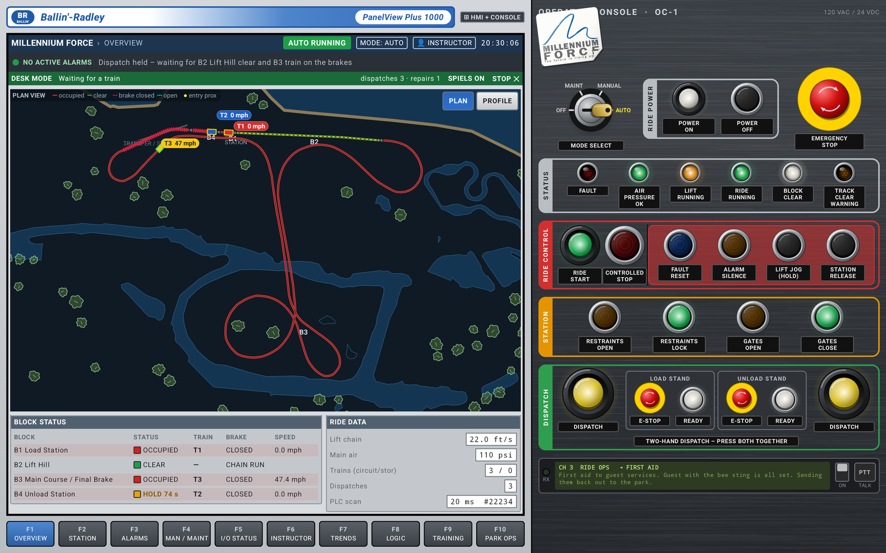
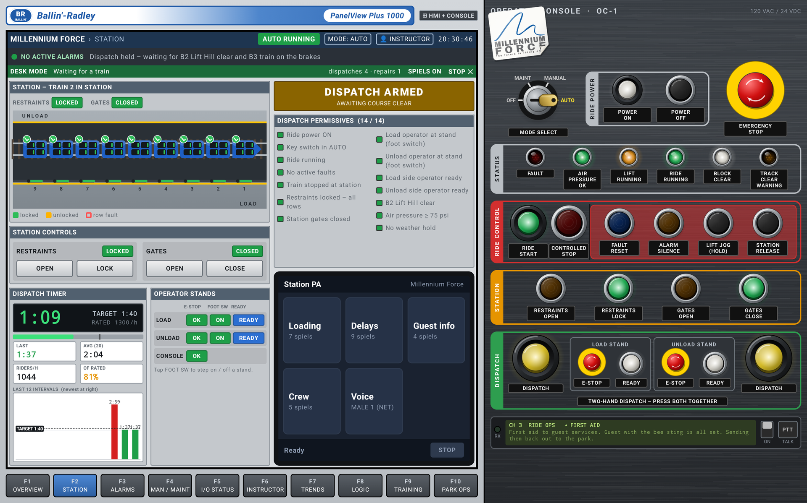
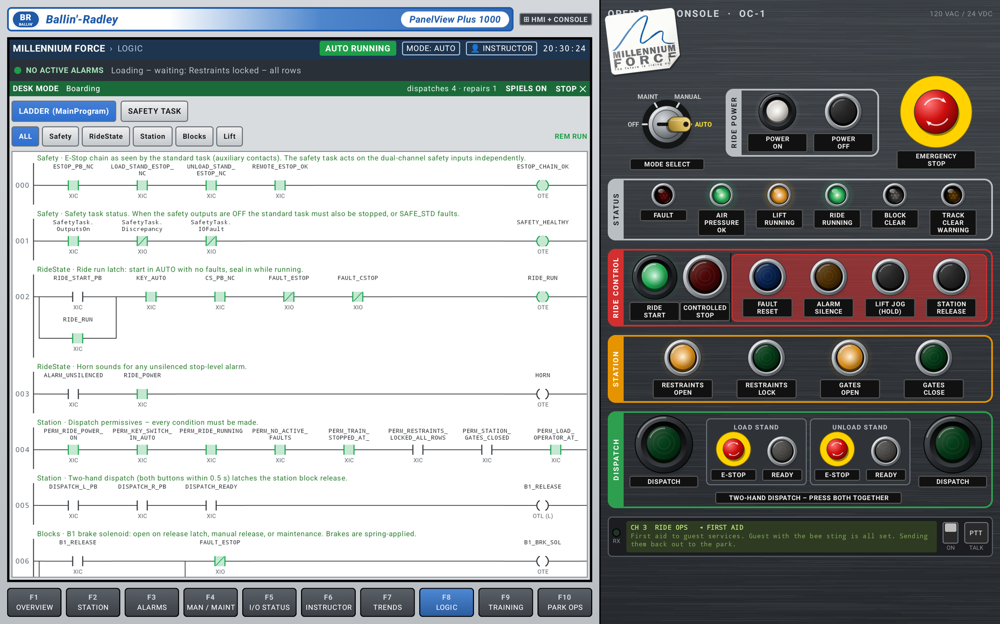
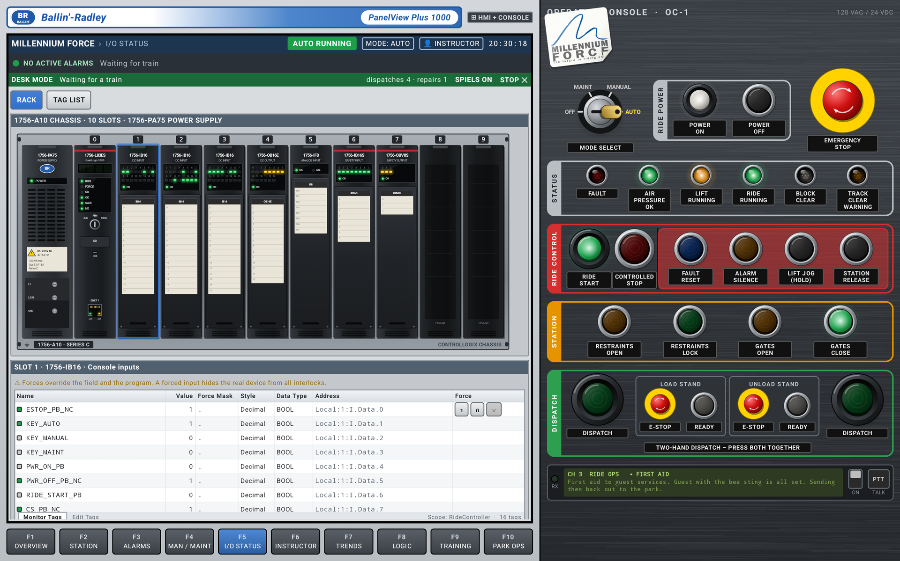
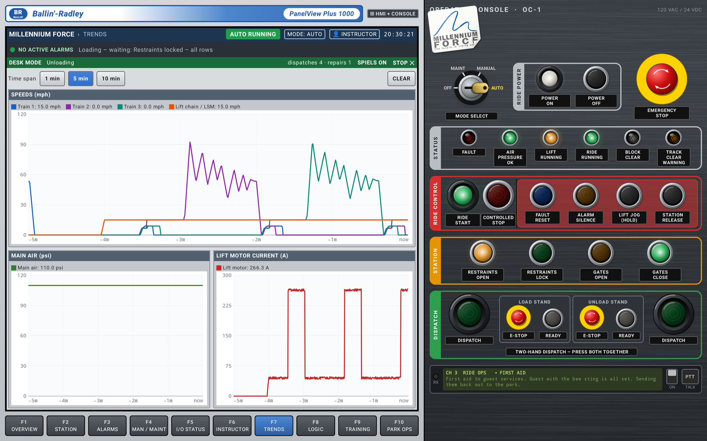
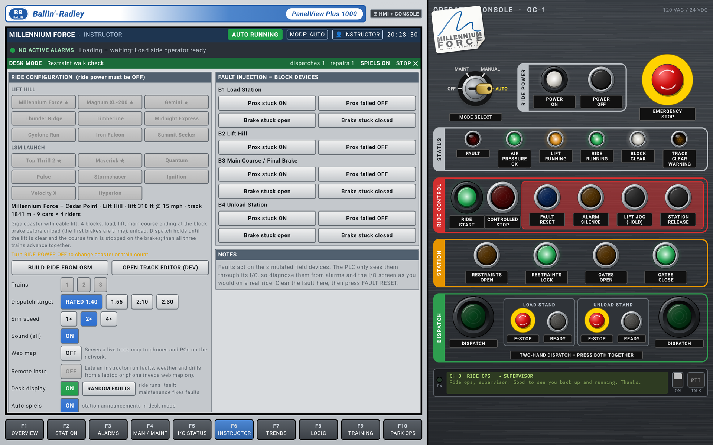
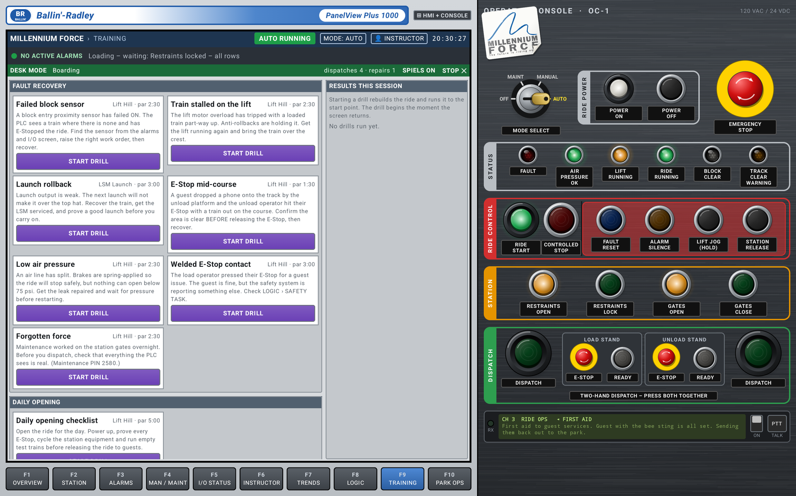
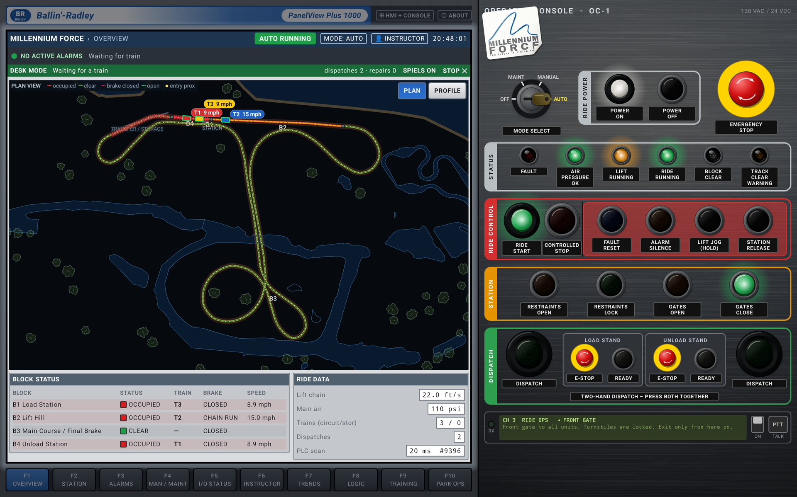
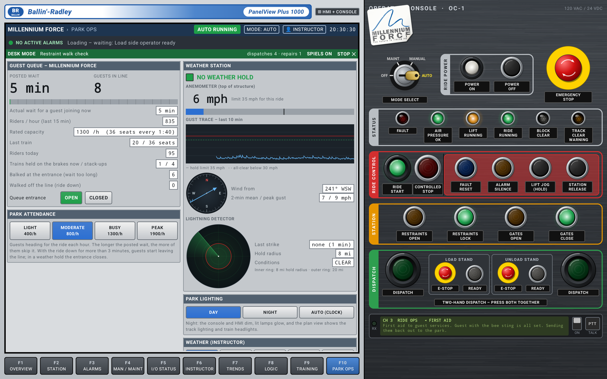

# Coaster Panel Sim 2026

A roller coaster ride control panel simulator for Android tablets. A touchscreen HMI sits beside a full operator
console, both driven by a simulated PLC running a fixed 20 ms scan, with the physics, block zones, interlocks and
failure modes modelled as closely as I could get them.



**[Download the latest APK](https://github.com/ProcioneDeConti/Coaster-Panel-Sim-2026/releases/latest)**:
Android 8.0+, built for large landscape tablets (designed on a Galaxy Tab S9 Ultra).

---

## Features

### The control system
- **Simulated ControlLogix-style PLC** with a 20 ms scan, plus a separate **GuardLogix-style safety task**:
  dual-channel E-Stops, channel discrepancy detection, safety relay and STO to the drives.
- **Block tracking** with entry proximity sensors, block brakes, brake position feedback, stacking on the brake runs,
  mid-course brakes, a station approach block and missed-arrival watchdogs.
- **Key switch modes**: OFF / MAINT / MANUAL / AUTO. MANUAL lets you hold block releases and jog the lift;
  MAINT bypasses interlocks for the transfer track and brake tests.
- **Dispatch done properly**: two-hand dispatch with real timing, operator foot switches, load and unload ready,
  a live permissive checklist, and held dispatches on rides that wait for the course to clear.
- **Per-seat restraints and seatbelts**, with an optional restraint walk: check every car before going ready.
- **Alarms with first-out**, fault reset, horn silence, an event history, and **I/O forcing** like Logix.
- **See inside the controller**: live ladder logic (main program and safety task), the I/O rack with module LEDs
  and tag monitor, and trends for train speeds, air pressure and lift motor current.

| Station | Ladder logic |
|---|---|
|  |  |
| **I/O rack** | **Trends** |
|  |  |

### The rides
- **Real layouts** (★ in the ride list) for **Millennium Force, Magnum XL-200, Gemini, Top Thrill 2 and Maverick**,
  built from OpenStreetMap track data with the real scenery around them.
- A dozen **fictional rides** generated from ride specs, covering both lift hill and LSM launch coasters.
- Chain and cable lifts, **LSM launches**, a **swing launch** with the rear spike and sliding switch track, tunnel
  launches, **paired dual-load stations**, **moving-block stations**, and a **transfer track** for storing trains.
- **Ride builder**: search OpenStreetMap for almost any coaster and pull its layout in. A track editor lets you tag
  your own block brakes, trims and sensors.

### Things that go wrong (on purpose)
- **Fault injection** from the instructor page: stuck or failed prox sensors, brakes stuck open or closed, air
  leaks, lift VFD and overload trips, LSM faults, welded E-Stop contacts, restraints that won't lock, stuck gates,
  safety I/O module faults.
- **Weather**: wind holds from the anemometer, lightning holds from the strike detector, and **headwind affects
  the launch**. A derated LSM in a strong headwind will roll back.
- **Rollback recovery** follows a procedure: train at rest, maintenance inspection sign-off, fault reset, return
  to the launch position, then an authorized relaunch.
- **Training drills** with par times and scoring: failed block sensor, train stalled on the lift, launch
  rollback, E-Stop mid-course, low air, welded E-Stop contact, a forgotten force, and a full daily opening checklist.

| Instructor | Training |
|---|---|
|  |  |

### Atmosphere
- **Synthesized ride sounds**: lift motor, anti-rollback clacks, LSM whine, brake pneumatics, gates and
  restraints, track clear sounder and fault horn.
- **Radio chatter** from the supervisor, maintenance and other areas, with recorded voices. Some calls need an
  answer on the push-to-talk.
- **Station music, station PA spiels**, haptics, and a **night mode** with track lighting and train headlights.
- **Guest queue** with a posted wait time. Guests balk at long waits and walk off the line when the ride is down.
- **Desk mode**: a virtual crew runs the ride by itself and maintenance fixes its faults, so the tablet can sit on
  a desk cycling trains.

| Night mode | Park ops |
|---|---|
|  |  |

### Remote instructor and web map
Turn on **Web map** on the instructor page and any browser on the same network can open a live plan view at
`http://<tablet-ip>:8080`. Turn on **Remote instr.** as well and `/instructor` gives a laptop or phone the
fault injection, weather, sim speed and drill controls, so an instructor can run a session without touching the
trainee's tablet.

---

## Getting started

1. Download the APK from the [latest release](https://github.com/ProcioneDeConti/Coaster-Panel-Sim-2026/releases/latest)
   and sideload it.
2. Turn the key to **AUTO**, press **POWER ON**, then **RIDE START**, and wait out the track clear warning.
3. Work through the station: open restraints and gates, close them, step on both foot switches, press READY on
   both stands, then press **both DISPATCH buttons together**.

Or open **F6 INSTRUCTOR** and switch on **Desk display** to watch the virtual crew do it.

| Access level | PIN |
|---|---|
| Operator | none |
| Maintenance | 2580 |
| Instructor | 1234 |

> **Upgrading from a build before v1.1?** v1.1 is signed with a new release key. Uninstall the old build first,
> since Android won't update an app signed with a different key.

---

## Building from source

Requirements: Android SDK 36 and **JDK 17 or 21**. Gradle 8.13 does not run on JDK 25, which recent Android Studio
versions bundle, so point `JAVA_HOME` at an older JDK if the build fails with just `25.0.x`.

```sh
./gradlew testDebugUnitTest   # simulation tests: ride cycles, faults, rollbacks, training drills
./gradlew assembleDebug       # debug build
./gradlew assembleFast        # optimized build signed with the debug key, for day-to-day use on a tablet
./gradlew assembleRelease     # release build
```

Release builds are signed with the key named in a `keystore.properties` file in the project root (git-ignored).
Without that file they are left unsigned.

```properties
storeFile=C:/path/to/release.jks
storePassword=...
keyAlias=...
keyPassword=...
```

Design notes and architecture: [DESIGN.md](DESIGN.md). Tools for regenerating the real layouts from OpenStreetMap:
[tools/osm](tools/osm/README.md).

---

## License

Copyright © 2026 ProcioneDeConti. Licensed under the **[GNU General Public License v3.0](LICENSE)** or later.

You're free to use, study, modify and share this project. If you distribute it or anything built from it, that
work must also be released under the GPL v3 with its source code available. Under the
[additional terms in NOTICE](NOTICE) (GPL v3 section 7(b)), every copy or modified version must keep this
attribution:

> Based on Coaster Panel Sim 2026 by ProcioneDeConti — https://github.com/ProcioneDeConti/Coaster-Panel-Sim-2026

---

## Credits and disclaimer

- Track layouts and scenery: map data © [OpenStreetMap](https://www.openstreetmap.org/copyright) contributors,
  available under the ODbL.
- Station spiels and radio voices are generated recordings (see `tools/spiels`).
- This is a fan project. It is not affiliated with or endorsed by any amusement park, ride manufacturer or controls
  vendor. Ride names belong to their owners. Real ride control systems vary a lot from ride to ride, so treat this
  as a realistic simulation, not a reference for operating a real attraction.
